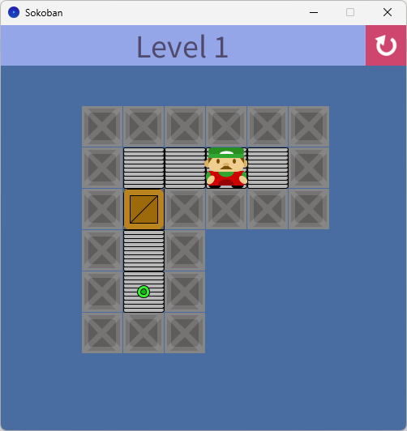
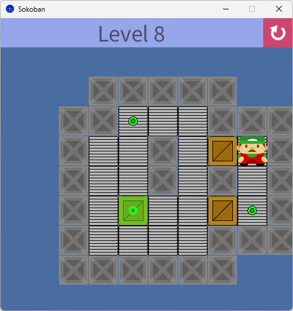
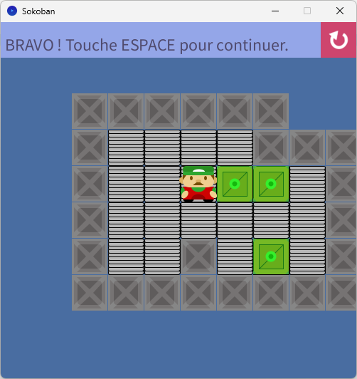

# Sokoban – Processing

Jeu de Sokoban développé en **Java avec Processing**, dans le cadre de l'UE *UED 131 – Programmation impérative* (L1 Informatique, Université d'Évry Paris-Saclay, 2024-2025).

<p align="center">
  
  
  
</p>

## Principe

Le joueur déplace le personnage dans une grille et pousse les caisses sur les cibles.
Il ne peut pousser qu'une seule caisse à la fois et ne peut pas tirer.
Un niveau est réussi quand toutes les cibles sont couvertes par une caisse.

## Fonctionnalités

- 26 niveaux chargés depuis des fichiers texte (`level1.skb` à `level26.skb`)
- Déplacement avec les flèches du clavier
- Détection de la victoire, puis passage au niveau suivant avec la touche **ESPACE**
- Bouton de rechargement du niveau (icône en haut à droite)
- Les caisses placées sur une cible deviennent vertes
- Musique de fond en boucle
- Graphismes entièrement dessinés par code (`rect`, `triangle`, `ellipse`, `arc`), sans aucun sprite pour le décor, les caisses, les murs et le personnage

## Commandes

| Action | Contrôle |
|---|---|
| Se déplacer / pousser une caisse | Flèches du clavier |
| Passer au niveau suivant (niveau résolu) | ESPACE |
| Recommencer le niveau | Clic sur l'icône en haut à droite |

## Lancer le projet

1. Installer [Processing](https://processing.org/download) (mode Java).
2. Installer la bibliothèque **Sound** : *Sketch > Import Library > Manage Libraries*, puis chercher « Sound ».
3. Ouvrir `Sokoban.pde` (le dossier du sketch doit s'appeler `Sokoban`).
4. Vérifier que le dossier `data/` contient bien `reload.png`, `sokoban.mp3` et les fichiers `level*.skb`.
5. Cliquer sur **Exécuter**.

## Structure du projet

```
Sokoban/
├── Sokoban.pde        # code du jeu
├── sketch.properties
└── data/
    ├── reload.png     # icône du bouton de rechargement
    ├── sokoban.mp3    # musique de fond
    └── level1.skb … level26.skb
```

## Fonctionnement du code

- **Niveaux** : `loadLevel()` lit un fichier `.skb` (largeur, hauteur, puis la grille) et remplit un tableau `map[][]` ainsi qu'un tableau `targets[][]` qui mémorise l'emplacement des cibles.
- **Affichage** : `drawMap()` parcourt la grille à chaque image et appelle une fonction de dessin par type de case (`drawWall`, `drawFloor`, `drawBox`, `drawTarget`, `drawAvatar`).
- **Déplacements** : `keyReleased()` calcule la case visée et la case suivante, puis vérifie si le personnage peut avancer ou pousser une caisse, en restaurant la cible quand une case est quittée.
- **Victoire** : `solved()` vérifie que chaque cible contient une caisse.

### Format des niveaux

Un fichier `.skb` contient la largeur, la hauteur, puis la grille en chiffres :

| Code | Signification |
|---|---|
| 0 | vide |
| 1 | sol |
| 2 | mur |
| 3 | caisse |
| 4 | cible |
| 5 | caisse sur cible |
| 6 | joueur |

Exemple (niveau 11) :

```
7
6
2222220
2465122
2311312
2111212
2114112
2222222
```

## Auteur

Samy Younsi – L3 Informatique, Systèmes et Réseaux, Université d'Évry Paris-Saclay
